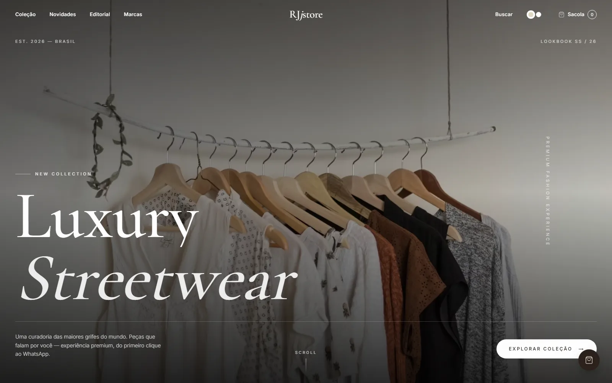
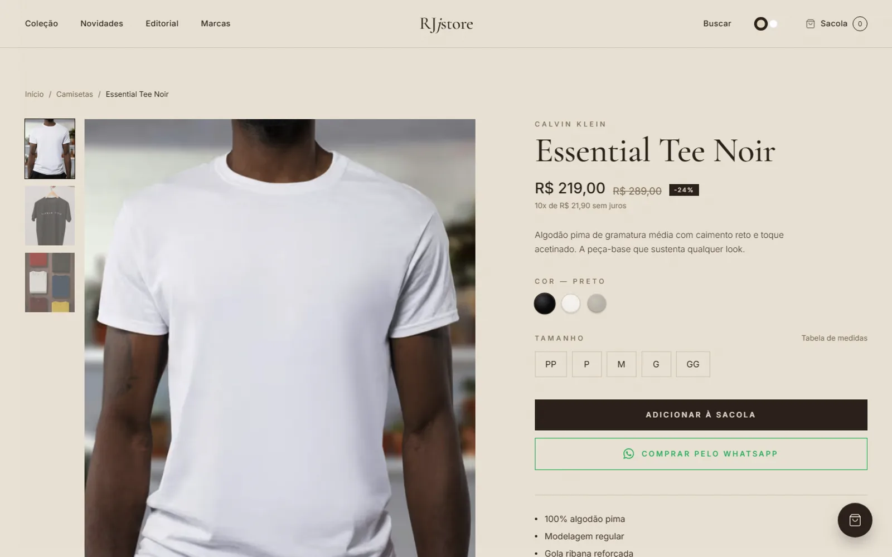

**English** | [Português](README.pt-BR.md)

# RJjstore — Luxury Streetwear

Storefront for a **premium multi-brand fashion** e-commerce with a luxury-studio look (editorial + lookbook + cinematic experience). Front-end only — orders are completed over **WhatsApp**; there is no backend and no online payment.

> **Type:** commercial demo (fictional brand — RJjstore is not a real store) · **Demo:** https://rjjstore.vercel.app

Demo built in partnership with Claude Code.





## Highlights

- **Cinematic hero** with parallax, slow-motion zoom and cursor-following lighting.
- **Pinned horizontal-scroll lookbook** with multi-layer depth.
- **Shop** (`/loja`) with 21 demo products, category/brand filters and price sorting.
- Product **quick view** modal with color/size selection.
- **Persistent cart** (`localStorage`) keyed by product **+ size**; checkout builds a ready-made message and opens `wa.me`.
- **Switchable theme** Sand & Espresso ⇄ Pure white (CSS variables, no flash, persisted).
- **Newsletter** form is visual only (nothing is sent — there is no backend).
- Preloader, masked page transitions, custom cursor, film grain, scroll-reactive marquees.
- **SEO**: metadata + OpenGraph + Twitter + JSON-LD (Store + Product), `sitemap`, `robots`, `opengraph-image`.
- **Accessibility**: managed focus in modals, `aria-pressed`, `prefers-reduced-motion`, keyboard navigation.

The UI text is in Brazilian Portuguese.

## Stack

Next.js 14.2 (App Router) · React 18 · TypeScript · Tailwind CSS 3 · Framer Motion · Lenis (smooth scroll) · `next/font` (Cormorant Garamond + Inter) · `next/image`.

## Getting started

Requirements: Node.js 18.17+ (CI uses Node 20) and npm.

```bash
npm ci
npm run dev      # http://localhost:3000
```

No environment variables are needed.

## Scripts

| Script | Description |
| --- | --- |
| `npm run dev` | development server |
| `npm run build` | production build |
| `npm run start` | serve the build |
| `npm run lint` | ESLint (`next lint`) |

Type check: `npx tsc --noEmit`. There are no automated tests. The `.github/workflows/ci.yml` workflow runs lint, type check and build.

## Project structure

```
src/
  app/                 # routes (home, /loja, /produtos/[slug]), sitemap, robots, og-image
  components/          # sections and commerce (Hero, ProductCard, CartDrawer, QuickView, ...)
    providers/         # CartProvider, QuickViewProvider, SmoothScroll
    ui/                # Reveal, Magnetic, CustomCursor, Spotlight, ThemeToggle, ...
  lib/                 # products (catalog), format, whatsapp, theme, ui
docs/screenshots/      # images used in this README
```

## Configuration

- **WhatsApp**: edit the constants in `src/lib/whatsapp.ts` (`WHATSAPP_NUMBER` / `WHATSAPP_DISPLAY`). The configured number is the business contact of MilWeb, which maintains the demo.
- **Site URL** (canonical, sitemap, robots): `SITE_URL` constant in `src/app/layout.tsx`, `src/app/sitemap.ts` and `src/app/robots.ts` (currently `https://rjjstore.vercel.app`).
- **Default theme**: Sand & Espresso. Toggle in the navbar (persisted in `localStorage`).

## Images and brands

- Photos are **demo images** loaded from Unsplash (`images.unsplash.com`, allowed in `next.config.mjs`); they are not official product photos. Replace them with your own in `src/lib/products.ts`.
- Brand names (Nike, Adidas, Lacoste, etc.) appear only as illustrative catalog text; they belong to their owners and there is no affiliation. No official logos are used.

## Limitations

Demo storefront: products, prices, descriptions, testimonials and figures are illustrative. There is no inventory, online payment, user accounts or backend — sales are closed over WhatsApp.

## Security

See [SECURITY.md](SECURITY.md). Contributing: [CONTRIBUTING.md](CONTRIBUTING.md).

## License

No license has been chosen yet; all rights reserved by the author.
